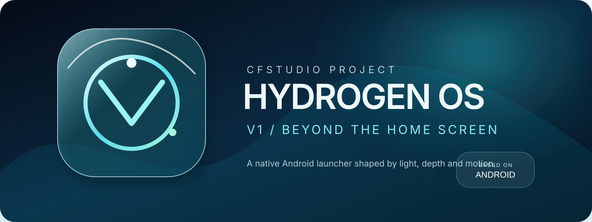
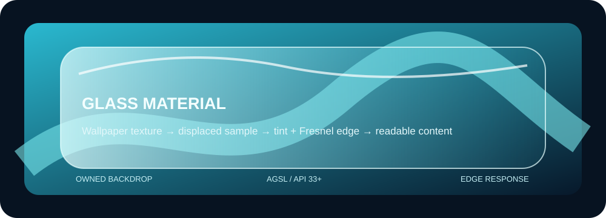
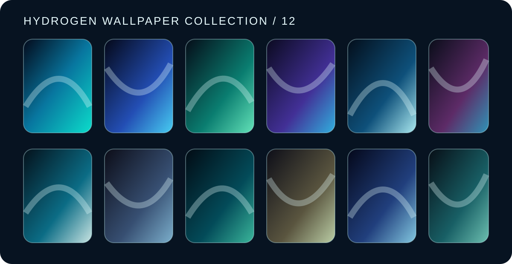

# Hydrogen OS V1

**Beyond the Home Screen.** Native third-party Android Home launcher with midnight / aqua visual language, app-owned glass rendering, procedural wallpapers and Android widget hosting.

> Hydrogen OS is an Android launcher, not firmware. It does not replace the lock screen, System UI, notification shade, or OEM settings.

## V1 feature map

| Area | Implementation |
|---|---|
| Home role | CATEGORY_HOME activity and user-confirmed RoleManager.ROLE_HOME flow |
| App library | Real launchable activities via LauncherApps; launch, search, grid/list, sort and favorites |
| Personalization | Dark/light/system, five accents, grid columns, icon size, labels and dock count |
| Wallpapers | 12 procedural Hydrogen compositions, Android Photo Picker and WallpaperManager |
| Widgets | AppWidgetHost / AppWidgetManager picker, configuration and provider size hints |
| Liquid Glass | API 33+ AGSL RuntimeShader displaces samples from Hydrogen's own wallpaper texture; fallback on API 26–32 |
| Intro | 6.5-second first-run/replay scene with indexed OpenGL ES 2.0 tear mesh, environment texture and ripple |
| Motion | Screen transition speed, Reduce Motion and Battery Saver |
| About | Hydrogen OS / V1 / Based on Android; honest default Not Found when no feed is configured |

## Honest V1 boundaries

- Glass samples only the wallpaper texture owned and rendered by Hydrogen. It cannot refract arbitrary pixels from other apps or System UI.
- No Accessibility, overlay, Usage Access or Notification Listener permissions are requested.
- Folder creation and drag-to-reorder are not implemented in this V1 source package.
- Weather, notification badges, update backend and automatic updater are not included.
- Droplet is a custom OpenGL ES 2.0 environment-textured mesh, not a full Filament PBR renderer.
- Build/runtime/performance are not verified until GitHub Actions and physical-device QA pass.

## Build with GitHub Actions

1. Open **Actions**.
2. Select **Hydrogen OS · Android CI**.
3. Choose **Run workflow** or push a commit to main.
4. After a successful run, download the HydrogenOS-V1-debug artifact.
5. Extract and install app-debug.apk.

The workflow installs JDK 17, Gradle 9.6.0 and Android SDK 36; generates the Gradle Wrapper on the runner; runs unit tests and assembleDebug; and uploads the APK. This text-only source package intentionally does not store a wrapper JAR.

## Select Hydrogen as Home

Install and open the APK, then choose **Hydrogen OS** in Android's system Home-app selection UI. Android requires user confirmation; Hydrogen never changes the default silently.

To switch back, use **Android Settings → Apps → Default apps → Home app** (OEM wording may vary) and select the manufacturer's launcher.

## Research & engineering notes

See [Architecture and research](docs/ARCHITECTURE.md) and the [QA matrix](docs/QA.md). Primary references:

- [Apple — Liquid Glass](https://developer.apple.com/documentation/TechnologyOverviews/liquid-glass)
- [Apple — Human Interface Guidelines: Materials](https://developer.apple.com/design/human-interface-guidelines/materials)
- [Apple — iOS 27 release announcement, 14 September 2026](https://www.apple.com/newsroom/2026/09/major-updates-for-apples-software-platforms-are-now-available/)
- [Android — RuntimeShader / AGSL](https://developer.android.com/reference/android/graphics/RuntimeShader)
- [Android — CATEGORY_HOME](https://developer.android.com/reference/android/content/Intent)
- [Android — AppWidgetHost](https://developer.android.com/reference/android/appwidget/AppWidgetHost)
- [Android — WallpaperManager](https://developer.android.com/reference/android/app/WallpaperManager)
- [Google Filament — Materials](https://google.github.io/filament/main/materials.html)

## License

MIT. See [LICENSE](LICENSE). Third-party AndroidX and Android platform components retain their respective licenses.
